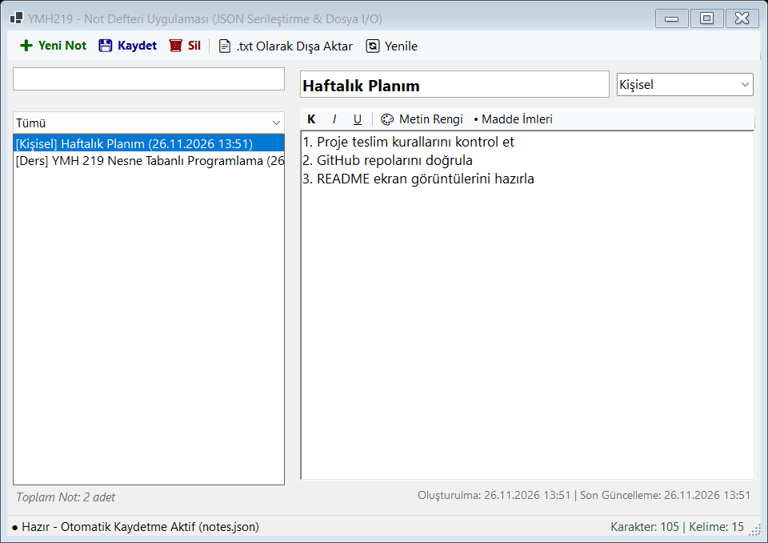
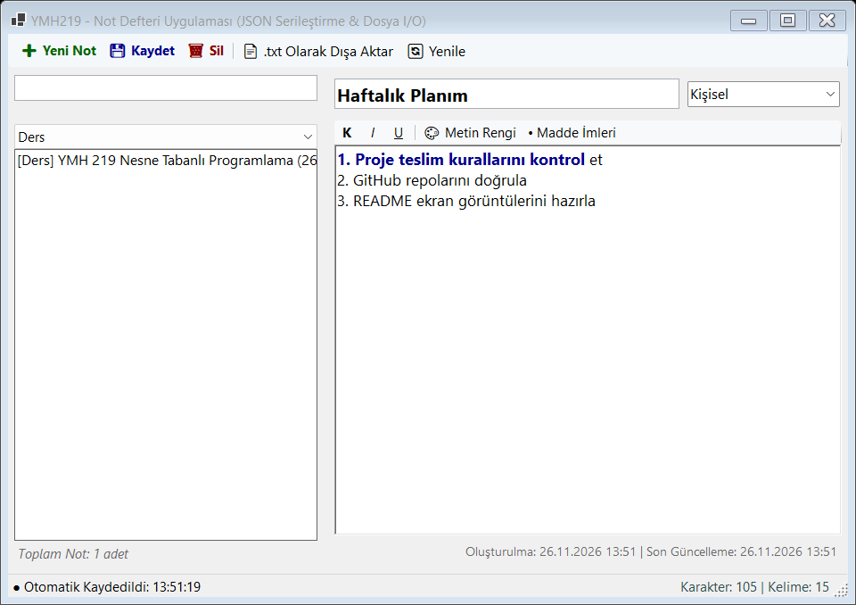

# YMH219 - Not Defteri Uygulaması (Dosya İşlemleri + Serileştirme)

Bu proje, Fırat Üniversitesi **Nesne Tabanlı Programlama (YMH 219)** dersi kapsamında Windows Forms ortamında C# dili kullanılarak geliştirilmiş bir masaüstü not defteri (Notepad) uygulamasıdır.

---

## 📌 Projenin Amacı ve Kısa Açıklama

Projenin temel amacı; verinin yerel dosya sistemine kalıcı olarak yazılıp okunması (File I/O) ve nesne yönelimli modellerin JSON formatında serileştirilmesi (Serialization) mekanizmalarını uygulamaktır. Uygulama kapatılıp yeniden açıldığında kaydedilen tüm notlar, kategorileri ve biçimlendirmeleriyle birlikte otomatik olarak geri yüklenir.

---

## 🛠️ Kullanılan Teknolojiler

- **Programlama Dili:** C# (.NET 10.0 / Windows Desktop SDK)
- **Serileştirme:** `System.Text.Json` (UnicodeRanges.All ile Türkçe karakter destekli girintili JSON)
- **Dosya Giriş / Çıkış (I/O):** `System.IO` (File.ReadAllText / WriteAllText, StreamWriter, UTF-8 kodlama)
- **Arayüz Çerçevesi:** Windows Forms (WinForms, RichTextBox, ToolStrip, SplitContainer, ListBox, ColorDialog)
- **Harici NuGet paketi:** Yok
- **Sürüm Kontrolü:** Git & GitHub

---

## 🚀 Kurulum ve Çalıştırma Adımları

### Gereksinimler
- Windows 10 veya Windows 11
- [.NET 10 SDK](https://dotnet.microsoft.com/download/dotnet/10.0)
- Visual Studio 2026 (".NET masaüstü geliştirme" iş yükü) **veya** komut satırı için yalnızca .NET 10 SDK

> Proje `net10.0-windows` hedeflediği için Visual Studio 2022 ile açılamaz.

### Çalıştırma
1. Projeyi bilgisayarınıza klonlayın veya zip olarak indirin:
   ```bash
   git clone https://github.com/BirgulGokturk/YMH219-NotepadApp.git
   ```
2. Proje dizinine gidin:
   ```bash
   cd YMH219-NotepadApp
   ```
3. Projeyi terminalden derleyip çalıştırın:
   ```bash
   dotnet build
   dotnet run
   ```
   *Veya `YMH219_NotepadApp.sln` dosyasını Visual Studio ile açarak F5 tuşuna basabilirsiniz.*

---

## ⚙️ Uygulamanın Temel Özellikleri

### 1. Asgari Uygulama Gereksinimleri
- **Kapsamlı CRUD İşlemleri:** Kullanıcı başlık, kategori ve içerikten oluşan notlar ekleyebilir, listeleyebilir, düzenleyebilir ve silebilir.
- **Kalıcı JSON Serileştirme:** Notlar `notes.json` dosyasına serileştirilerek kaydedilir; program açıldığında bu dosyadan otomatik geri yüklenir.
- **Düz Metin (.txt) Dışa Aktarma:** "📄 .txt Olarak Dışa Aktar" butonu ile seçili not, başlık, kategori ve tarih damgalarıyla birlikte metin belgesi olarak kaydedilir.
- **Tarih Takibi:** Her notun oluşturulma (`CreatedAt`) ve son düzenlenme (`UpdatedAt`) zaman damgaları sistemde tutulur ve arayüzde gösterilir.
- **Hata Yönetimi ve Kurtarma:** Dosya bulunamadığında veya JSON formatı bozulduğunda uygulama çökmez. Bozuk dosya `notes.json.bak_tarih` adıyla yedeklenir, uygulama örnek notlarla açılır ve kullanıcıya yedeğin yerini gösteren bir uyarı verilir. Not dosyası kilitli olduğu için otomatik kayıt yapılamazsa durum çubuğunda bildirilir.

### 2. İsteğe Bağlı / Ek Geliştirmeler (Bonus)
- 🔍 **Canlı Arama ve Kategori Filtreleme:** Arama kutusuna yazıldıkça başlık, içerik ve kategoride anlık filtreleme yapılır; açılır kutudan kategoriye (Ders, Kişisel, İş vb.) göre notlar listelenebilir. Seçilen filtre not kaydedildiğinde korunur.
- 💾 **Otomatik Kaydetme (Auto-Save):** Kullanıcı başlığı, içeriği, biçimlendirmeyi veya kategoriyi değiştirdiği anda not `notes.json` dosyasına yazılır. "Yeni Not" ile başlanan not, ilk karakter yazıldığında otomatik oluşturulur; başka nota geçmek veya uygulamayı kapatmak yazılanları kaybettirmez.
- 🏷️ **Kategori Desteği:** Notlara kategori atanabilir, mevcut kategoriler otomatik listelenir.
- 🎨 **Zengin Metin (RichTextBox) Biçimlendirme:**
  - **K** (Kalın / Bold)
  - *I* (İtalik / Italic)
  - <u>U</u> (Altı Çizili / Underline)
  - 🎨 Renk Seçici (ColorDialog)
  - • Madde İmleri (Bullet Points)
- 📊 **Kelime ve Karakter Sayacı:** Notun anlık karakter ve kelime sayısı durum çubuğunda canlı olarak gösterilir.

---

## 📸 Ekran Görüntüleri

| Not Listesi ve Ana Düzenleme Ekranı | Kategori Filtreleme ve Zengin Metin |
|:---:|:---:|
|  |  |

---

## 🏗️ Nesne Tabanlı Mimari

```
YMH219-NotepadApp/
├── Models/
│   └── Note.cs              # Not başlığı, içeriği, kategorisi, RTF ve tarih modeli
├── Services/
│   └── NoteManager.cs       # List<Note> koleksiyonu, JSON serileştirme/yükleme, arama ve .txt export servisi
├── screenshots/
│   ├── ekran1.png
│   └── ekran2.png
├── Form1.cs                 # Form olayları, zengin metin formatlama ve UI bağlama
├── Form1.Designer.cs        # Not listesi, araç çubuğu ve zengin metin editörü bileşenleri
├── Program.cs               # Giriş noktası
├── YMH219_NotepadApp.csproj
└── YMH219_NotepadApp.sln
```

---

## 📝 Bilinen Sınırlamalar / Geliştirme Notları

- Notlar uygulamanın çalışma dizinindeki (`bin/.../`) `notes.json` dosyasında saklanır; bu klasör silinirse notlar da silinir.
- Otomatik kayıt her değişiklikte tüm notları dosyaya yeniden yazar; çok sayıda veya çok büyük notta yazarken gecikme olabilir. Gelecekte kaydı son tuştan kısa bir süre sonraya erteleyen bir zamanlayıcı eklenebilir.
- İlerleyen sürümlerde parola korumalı şifreli notlar ve bulut yedekleme desteği eklenebilir.

---

## 👤 Öğrenci Bilgileri

- **Adı Soyadı:** Birgül Göktürk
- **Öğrenci Numarası:** 250541094
- **Ders:** Nesne Tabanlı Programlama (YMH 219)
- **Dönem:** 2026-2027 Güz
